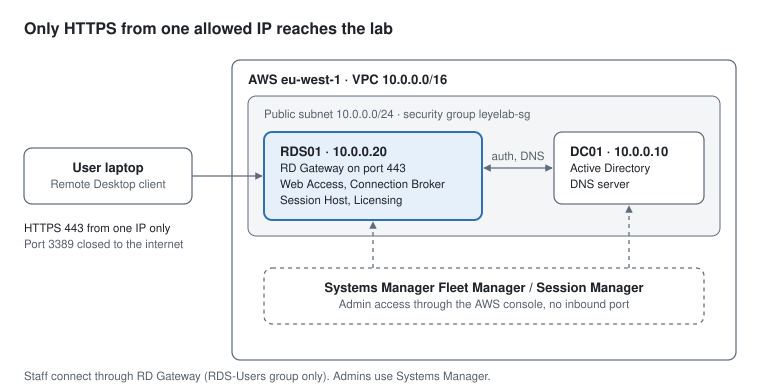

# Secure Remote Desktop Services on AWS (Lab)

A two-server Windows domain on AWS where staff reach their desktops and apps through **RD Gateway over HTTPS**, port 3389 is closed to the internet, and administrators manage the servers through **AWS Systems Manager** with no inbound ports at all.

I built this lab between 30 October and 6 November 2026 to get hands-on with the work behind remote desktop and IT support jobs: Active Directory, DNS, Group Policy, Remote Desktop Services, certificates and AWS networking. Then I broke it on purpose eight times and fixed it, with screenshots of each failure, the evidence and the fix.

> This is a personal lab, not client work. Every screenshot comes from my own AWS account, with account IDs, public IPs and hostnames blacked out.



## What this lab shows

| Area | What I did |
| --- | --- |
| AWS networking | Built a VPC, public subnet, route table and internet gateway; locked access down with a security group that only allows HTTPS from one IP |
| Active Directory | Promoted a domain controller for `leyelab.internal`, created OUs, users and a security group with PowerShell |
| DNS | Fixed a domain that came up without its DNS server: installed the role, confirmed the AD-integrated zones and re-registered the SRV records |
| Remote Desktop Services | Deployed Session Host, Connection Broker, Web Access and Licensing; published RemoteApps; limited access to one security group |
| Group Policy | Enforced Network Level Authentication, SSL, high encryption, idle and disconnect limits, no drive redirection, and account lockout |
| RD Gateway and certificates | Put RD Gateway in front of the session host, issued a certificate with the right key usage and names, and restricted the gateway to one group |
| Secure administration | Used Systems Manager Fleet Manager and Session Manager, with an IAM role instead of stored credentials |
| Troubleshooting | Diagnosed 11 real problems during the build and 8 deliberate failures, using event logs, PowerShell and network tests |

## Environment

| Item | Value |
| --- | --- |
| Region | eu-west-1 (Ireland) |
| Network | VPC `10.0.0.0/16`, public subnet `10.0.0.0/24` |
| DC01 | Windows Server 2022, t3.small, `10.0.0.10`, AD DS and DNS |
| RDS01 | Windows Server 2022, m7i-flex.large, `10.0.0.20`, RD Session Host, Connection Broker, Web Access, Licensing, RD Gateway |
| Domain | `leyelab.internal` (NetBIOS `LEYELAB`) |
| Access | RD Gateway on HTTPS 443 for staff; Systems Manager for admins |
| Cost | Ran on AWS free plan credits, with servers stopped between sessions |

## How it was built

| Phase | Result | Evidence |
| --- | --- | --- |
| 1. Network | VPC, subnet, internet gateway, security group, key pair, IAM role for Systems Manager | [VPC map](screenshots/build/01-vpc-resource-map.png), [first rules](screenshots/build/02-security-group-initial-rules.png) |
| 2. Domain controller | DC01 promoted; DNS forwarder to the AWS resolver | [domain created](screenshots/build/03-domain-created.png) |
| 3. Users and groups | OUs for Staff, Groups and Servers; five users; RDS-Users group | [users](screenshots/build/04-ad-staff-users.png), [group](screenshots/build/05-rds-users-group.png) |
| 4. Member server | RDS01 joined straight into the Servers OU | [RDS01 in OU](screenshots/build/06-rds01-in-servers-ou.png) |
| 5. Remote Desktop Services | Session-based deployment, collection, Notepad and Paint as RemoteApps | [deployment](screenshots/build/07-rds-deployment-overview.png), [RemoteApps](screenshots/build/08-remoteapp-programs.png), [web portal](screenshots/build/09-rd-web-access-portal.png), [RemoteApp running](screenshots/build/10-remoteapp-notepad.png) |
| 6. Group Policy | RDP hardening GPO on the Servers OU; account lockout at domain level | [GPO settings](screenshots/build/11-gpo-rdp-security-settings.png), [gpresult](screenshots/build/12-gpresult-on-rds01.png) |
| 7. RD Gateway | Certificate for every role, gateway limited to RDS-Users, port 3389 closed | [certificates](screenshots/build/13-deployment-certificates.png), [gateway policy](screenshots/build/14-gateway-cap-rds-users.png), [final rules](screenshots/build/15-security-group-final-rules.png), [client settings](screenshots/build/16-client-gateway-settings.png), [live session](screenshots/build/17-gateway-monitoring.png) |
| 8. Secure admin access | Both servers managed through Fleet Manager with no open ports | [managed nodes](screenshots/build/18-fleet-manager-nodes.png), [browser RDP](screenshots/build/19-fleet-manager-remote-desktop.png) |

Full details and commands: [docs/build-log.md](docs/build-log.md). The PowerShell I used is in [scripts/](scripts/).

## Break-and-fix scenarios

Each scenario has three screenshots: the symptom a user would see, the evidence that shows the cause, and proof the fix worked. Full write-ups: [docs/break-fix-scenarios.md](docs/break-fix-scenarios.md).

| # | What I broke | How I found the cause |
| --- | --- | --- |
| 1 | A user outside the allowed group tried to connect | Gateway event 201, error 23003: authenticated but not authorised |
| 2 | Five wrong passwords locked an account | `LockedOut` in Active Directory and event 4740 on the domain controller |
| 3 | Pointed the session host at the wrong DNS server | `gpupdate` failed and `Resolve-DnsName` returned "DNS name does not exist" |
| 4 | Removed the HTTPS firewall rule | `Test-NetConnection` showed the port was blocked before reaching the server |
| 5 | Connected to the gateway by IP instead of its name | The certificate was only issued to the gateway's name |
| 6 | Stopped the RD Gateway service | `Get-Service TSGateway` showed it stopped while port 443 was still open |
| 7 | Shut down the only domain controller | Logins failed, and Session Manager failed too because the session host used DC01 for all DNS |
| 8 | Left a session idle | The 30-minute Group Policy limit disconnected it; reconnecting restored the user's open work |

## Real problems I hit while building it

These weren't planned. Each one is written up in [docs/troubleshooting-log.md](docs/troubleshooting-log.md).

- The first server launch failed because the planned IP sat outside the subnet's range. Subnet ranges can't be edited, so I re-planned the addresses.
- The domain came up **without its DNS server**. I installed the role, found the zones already existed in Active Directory (error 9609), and re-registered the domain controller's SRV records.
- Chrome refused the RD Web Access page with `ERR_SSL_KEY_USAGE_INCOMPATIBLE`. I issued a new certificate with the correct key usage and bound it in IIS.
- After I deleted the RDP firewall rule, my session **stayed connected**, because security groups are stateful.
- Gateway refusals weren't being logged at all. The cause was my **home IP changing**: the traffic never reached the server.
- Shutting down the domain controller also cut off Systems Manager, which exposed a DNS single point of failure.

## What I'd change for production

- **Two domain controllers** in different Availability Zones, both running DNS, with servers using both.
- **Private subnets** for every server, with outbound traffic through a NAT gateway or VPC endpoints.
- A **publicly trusted certificate** on the company's own domain, so no device needs a certificate installed.
- **Multi-factor authentication** on the gateway, for example Microsoft Entra MFA through the NPS extension.
- **Activated RDS licensing** with client access licences, instead of the 120-day grace period.
- **Session Manager logging** to S3 or CloudWatch, and unique local admin passwords managed by LAPS.

## Repository layout

```
docs/
  architecture.svg          diagram above
  build-log.md              phase-by-phase build with commands
  break-fix-scenarios.md    eight deliberate failures, three screenshots each
  troubleshooting-log.md    real problems hit during the build
scripts/                    PowerShell used in the lab (no passwords stored)
screenshots/
  build/                    19 build screenshots
  break-fix/                24 scenario screenshots
```

## Author

**Olamileye (Leye) Duduyemi**, IT support. B.Eng Electronics and Computer Engineering, Lagos State University.
