# Break-and-fix scenarios

After the build, I broke the environment on purpose eight times. For each one I recorded what a user would see, found the cause with logs and tools, fixed it, and noted how to prevent it. Each has three screenshots: **a** the symptom, **b** the evidence, **c** the fix working.

Before every test I checked that my laptop could still reach the gateway (`Test-NetConnection <gateway> -Port 443`), because a changed home IP makes every test fail for the wrong reason.

---

## 1. A user who isn't allowed in

| | |
| --- | --- |
| **Symptom** | Musa was told his account wasn't authorised to access the RD Gateway |
| **Cause** | He isn't in `RDS-Users`, the only group the gateway's Connection Authorization Policy allows |
| **Fix** | Added him to `RDS-Users`; he connected on the next attempt |
| **Prevent** | Grant access through groups, and check group membership first when one user can't connect |

The gateway log (event 201) showed his password was accepted but he didn't meet the policy, error 23003. In other words he was **authenticated** but not **authorised**. The same refusal also appears in the Security log as Network Policy Server event 6273, because RD Gateway hands its permission check to NPS.

| a. Symptom | b. Evidence | c. Fixed |
| --- | --- | --- |
| 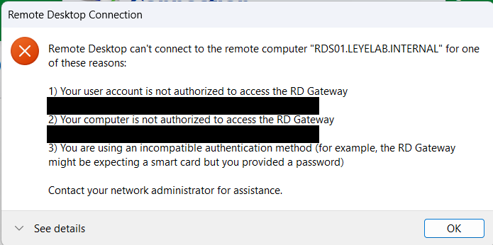 | 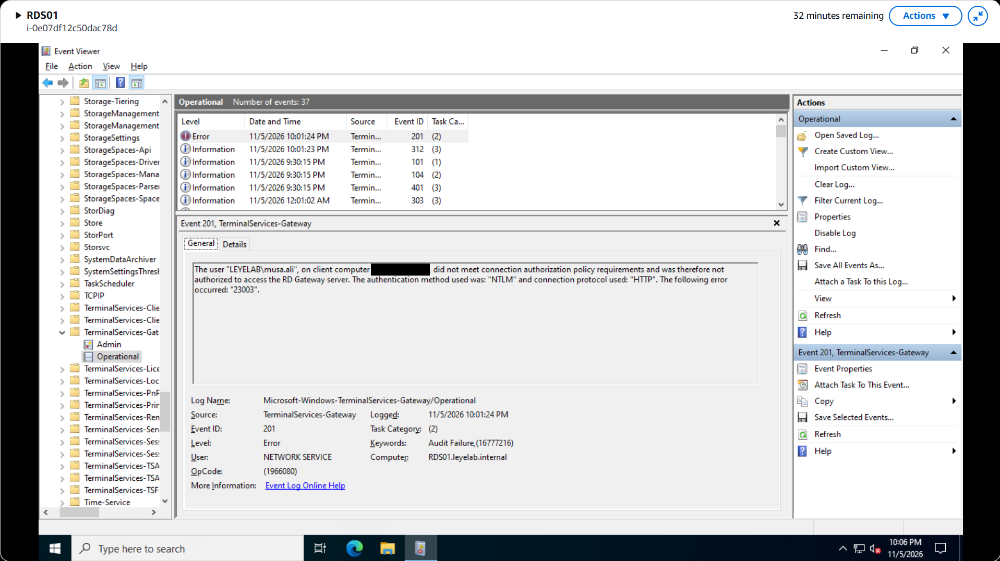 | 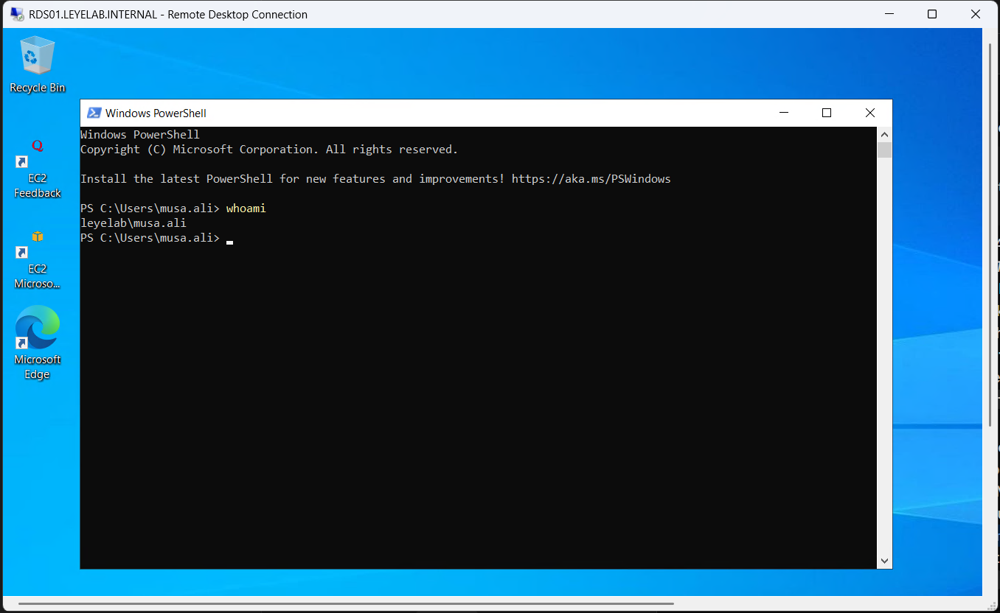 |

## 2. A locked-out account

| | |
| --- | --- |
| **Symptom** | Grace only saw "The logon attempt failed", even with her correct password |
| **Cause** | Five wrong passwords triggered the domain lockout policy |
| **Fix** | `Unlock-ADAccount grace.eze`, then confirmed `LockedOut` was `False` |
| **Prevent** | Keep the lockout threshold and duration balanced; train users to reset rather than guess |

Through the gateway, Windows never says an account is locked, so an attacker can't learn which accounts exist. The proof was the correct password failing. Event 4740 on DC01 named the locked account and the computer the bad attempts came from.

| a. Symptom | b. Evidence | c. Fixed |
| --- | --- | --- |
| 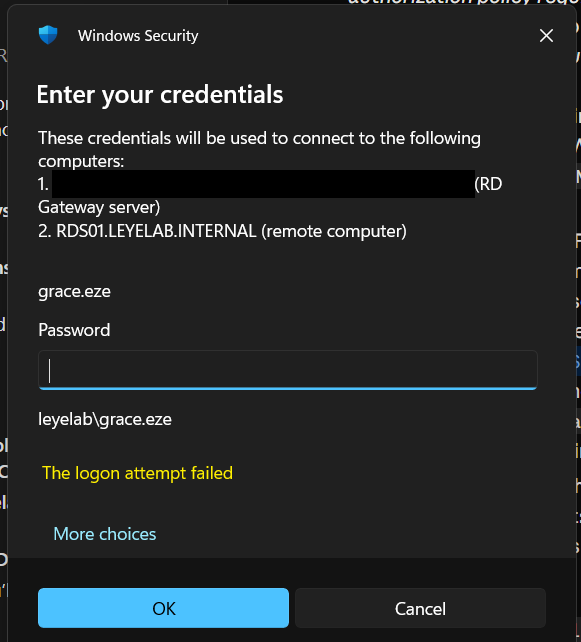 | 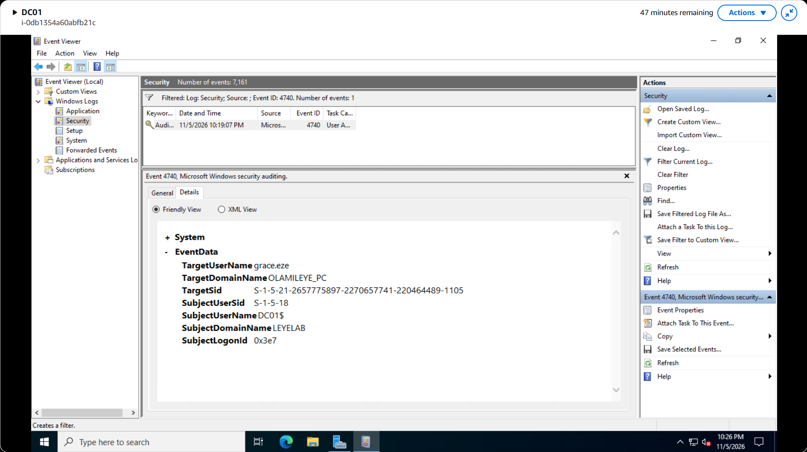 | 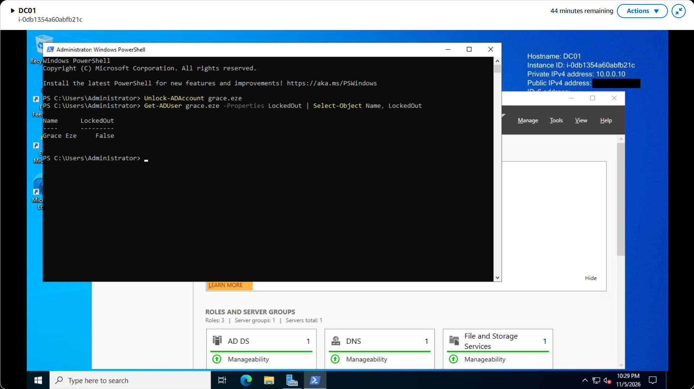 |

## 3. Broken DNS on a member server

| | |
| --- | --- |
| **Symptom** | `gpupdate /force` on RDS01 failed: Windows could not resolve the computer or user name |
| **Cause** | I pointed RDS01's DNS at `8.8.8.8`, which knows nothing about `leyelab.internal` |
| **Fix** | Set DNS back to `10.0.0.10`; the lookup, `Test-ComputerSecureChannel` and `gpupdate` all succeeded |
| **Prevent** | Domain members use only domain DNS servers; never add a public resolver as a backup |

`Resolve-DnsName leyelab.internal` returning "DNS name does not exist" told me it was DNS straight away.

| a. Symptom | b. Evidence | c. Fixed |
| --- | --- | --- |
| 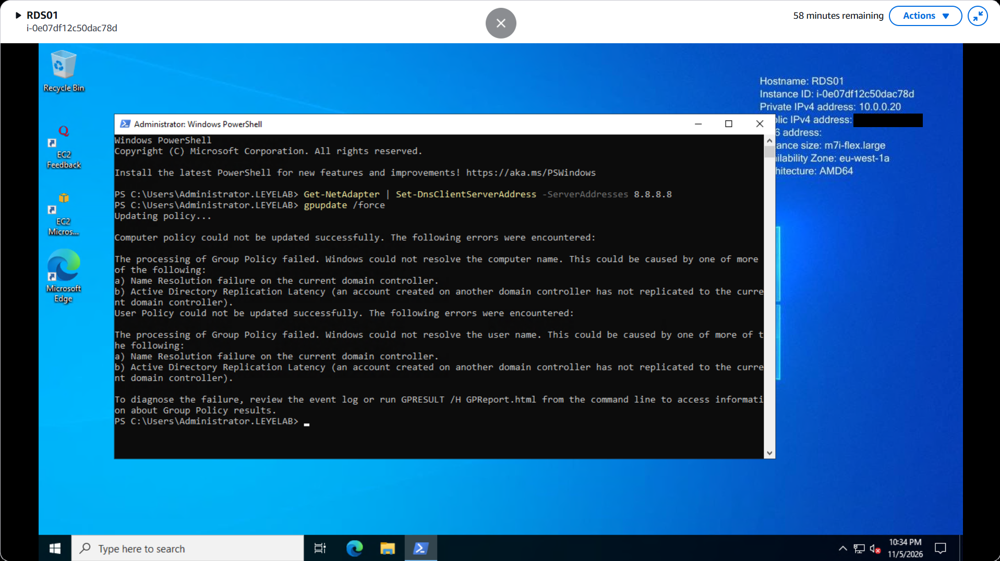 |  | 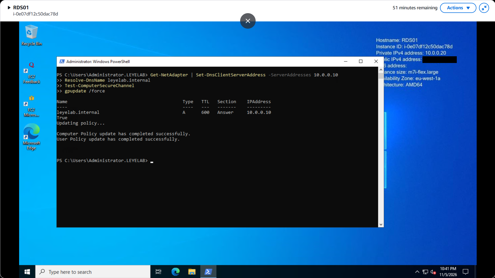 |

## 4. A blocked firewall port

| | |
| --- | --- |
| **Symptom** | The Remote Desktop client gave a generic "problem connecting to the remote resource" |
| **Cause** | I deleted the HTTPS rule from the security group |
| **Fix** | Restored the rule; `TcpTestSucceeded` went from `False` to `True` and the session connected |
| **Prevent** | Test the network path first when nothing reaches the server; it's the same failure as a changed home IP |

The server logged nothing, because no traffic ever reached it.

| a. Symptom | b. Evidence | c. Fixed |
| --- | --- | --- |
| 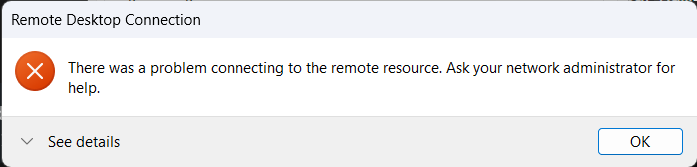 | 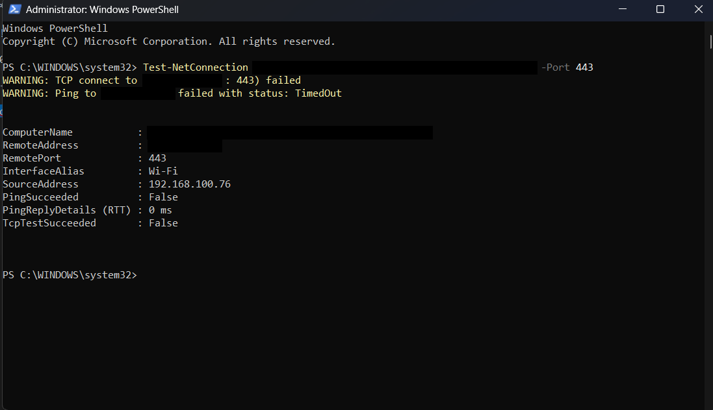 | 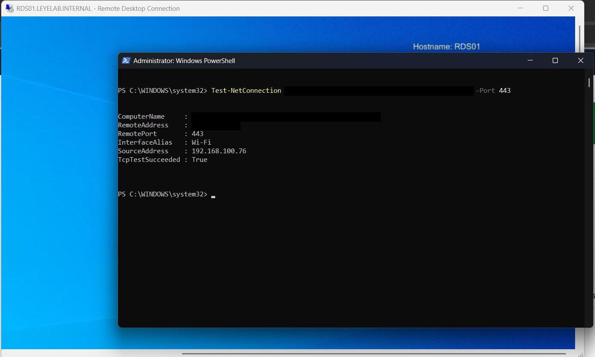 |

## 5. A certificate name mismatch

| | |
| --- | --- |
| **Symptom** | Connecting to the gateway by its IP failed with error `0x3000008` |
| **Cause** | The gateway certificate is only issued to the gateway's DNS name, not to an IP |
| **Fix** | Used the gateway name again and the connection worked |
| **Prevent** | Users connect by the name on the certificate; production uses a public certificate on the company's domain |

The error code is generic, so I proved the cause by changing one setting at a time and checking the certificate's issued-to name. While testing, I first put the IP in the wrong box (the target computer instead of the gateway). That gave a different refusal from the gateway's Resource Authorization Policy, which only lets users reach approved internal computers.

| a. Symptom | b. Evidence | c. Fixed |
| --- | --- | --- |
| 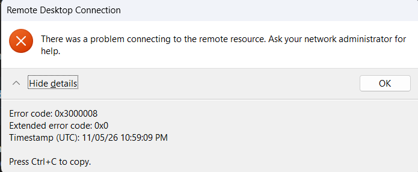 | 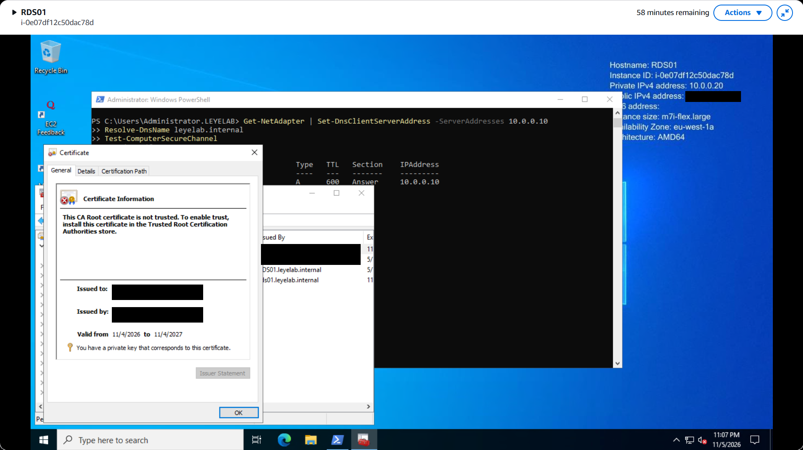 | 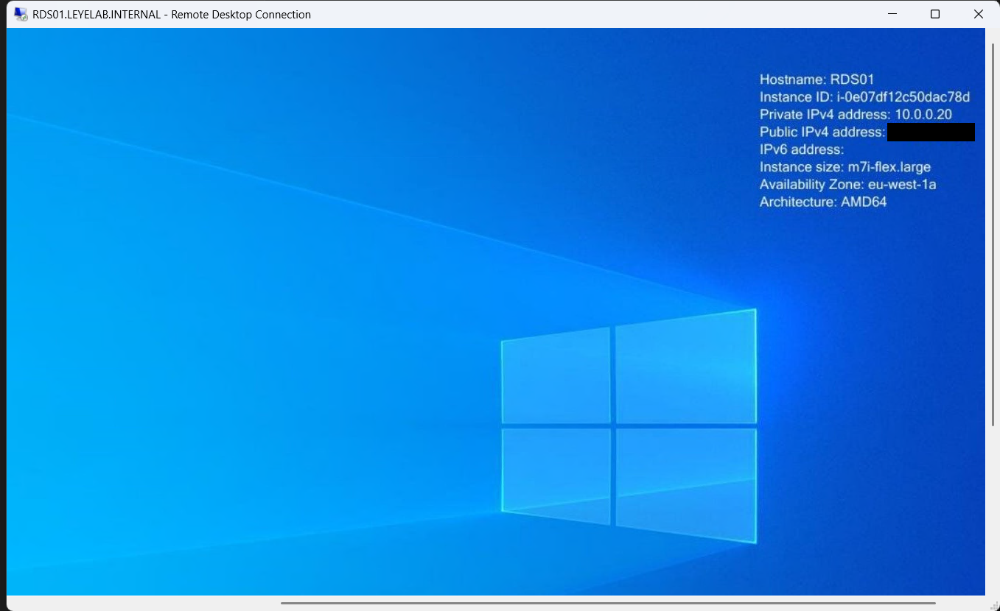 |

## 6. A stopped gateway service

| | |
| --- | --- |
| **Symptom** | "The remote resource can't be reached" (`0x300000d`), even though port 443 was open |
| **Cause** | I stopped the `TSGateway` service |
| **Fix** | `Start-Service TSGateway`; the status returned to Running and Amaka connected |
| **Prevent** | Monitor critical services and set them to start automatically |

Scenarios 4 and 6 look almost identical to a user. One is the network, the other is the service, which is why I check both.

| a. Symptom | b. Evidence | c. Fixed |
| --- | --- | --- |
| 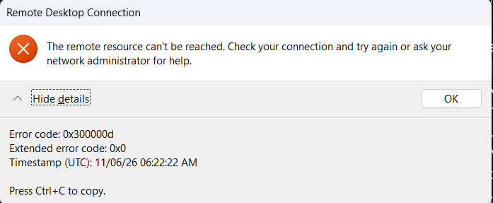 | 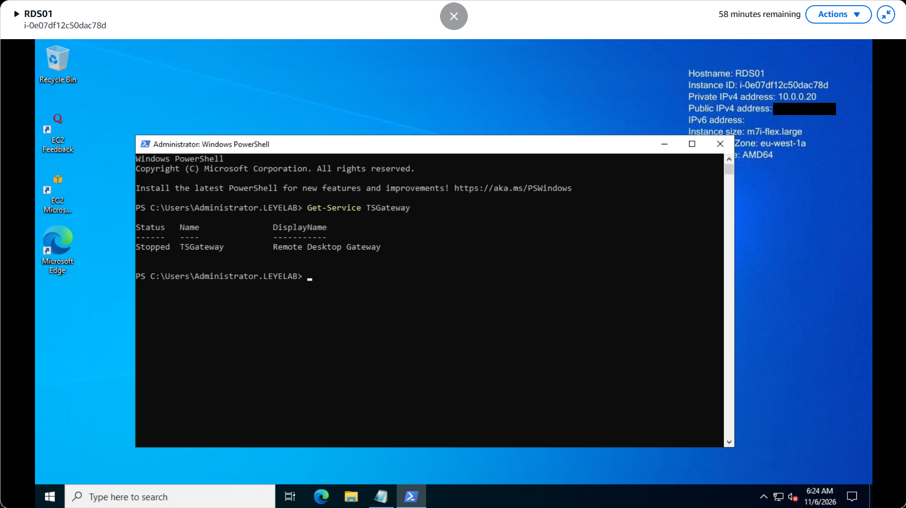 | 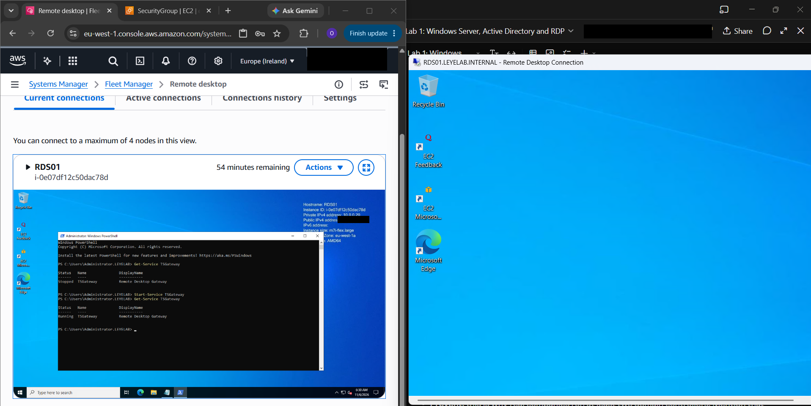 |

## 7. The domain controller is down

| | |
| --- | --- |
| **Symptom** | With DC01 stopped, Amaka's connection failed even though her password was right |
| **Cause** | The gateway checks every login with DC01 |
| **Fix** | Started DC01; once RDS01 showed Online again in Fleet Manager, Amaka connected |
| **Prevent** | Run at least two domain controllers, both running DNS |

This one went further than expected. Session Manager couldn't reach RDS01 either: it failed with "lookup ssmmessages.eu-west-1.amazonaws.com: no such host". RDS01 used DC01 as its only DNS server, so with DC01 down it couldn't look up *any* name, including the AWS address its management agent needs. One stopped server took out logins, DNS and my admin access to a different server.

| a. Symptom | b. Evidence | c. Fixed |
| --- | --- | --- |
| 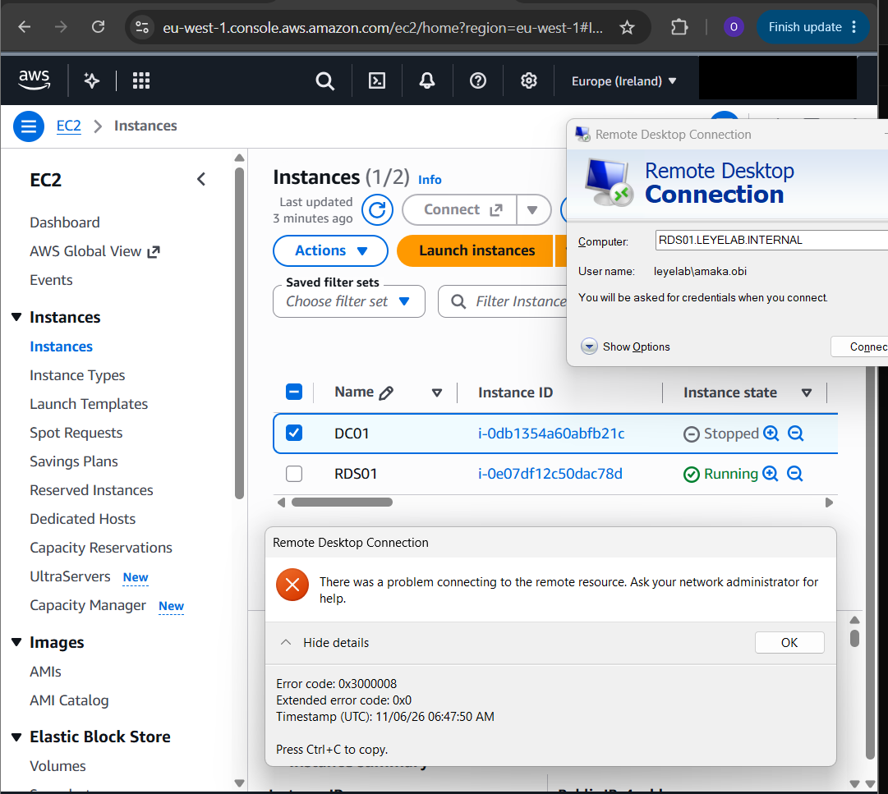 | 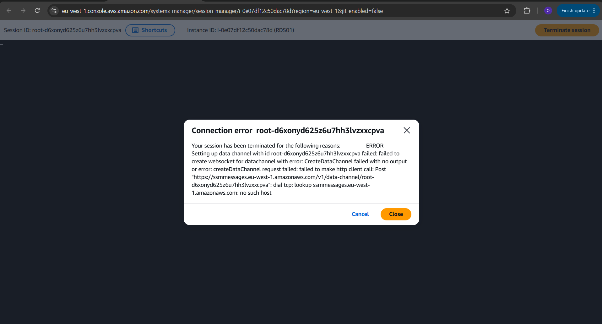 | 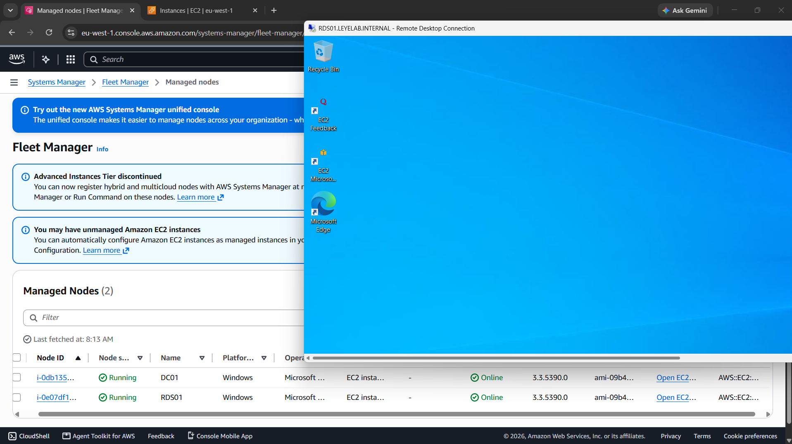 |

## 8. An idle session

| | |
| --- | --- |
| **Symptom** | Amaka's session disconnected after she left it alone |
| **Cause** | Not a fault: the 30-minute idle limit from the Group Policy |
| **Fix** | None needed. She reconnected within the hour and the Connection Broker put her back into her session, with her unsaved Notepad text still there |
| **Prevent** | Explain the policy to users; the 1-hour disconnect limit protects their work |

| a. Symptom | b. Evidence | c. Fixed |
| --- | --- | --- |
| 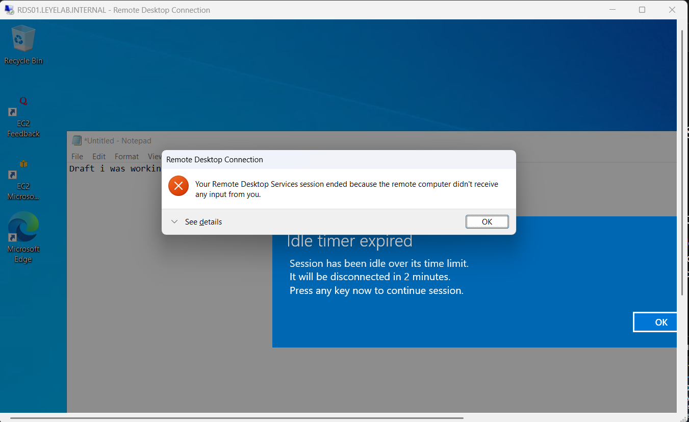 | 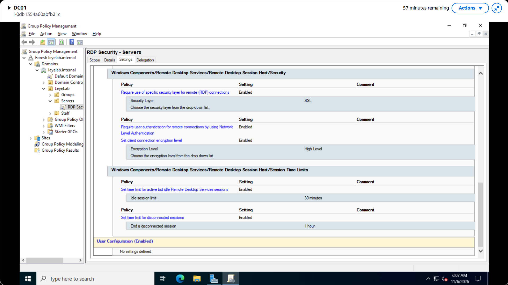 | 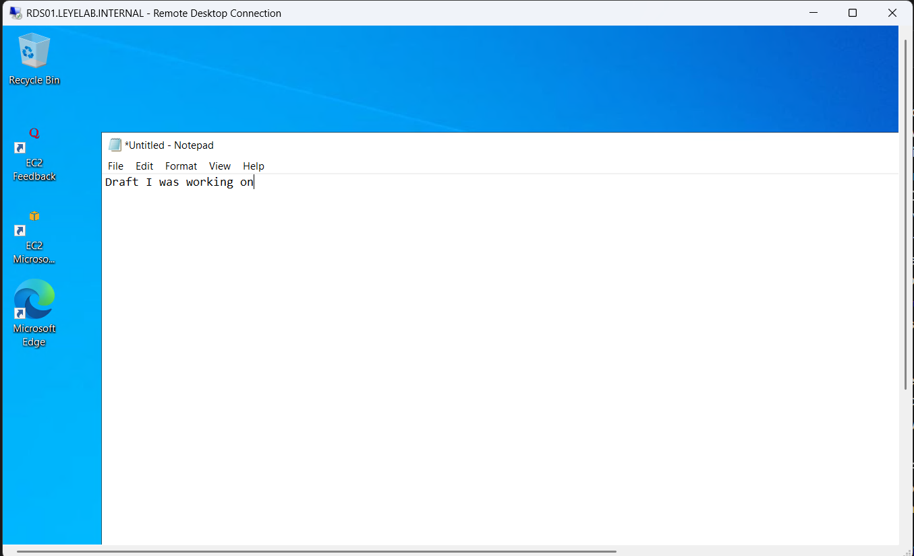 |
