# Build log

How the lab was built, phase by phase, with the commands I ran. The reusable PowerShell is in [../scripts](../scripts). Passwords were always typed at a prompt and never stored in a script.

## Phase 1: Network

- VPC `leyelab-vpc` (`10.0.0.0/16`) in eu-west-1, one Availability Zone, one public subnet (`10.0.0.0/24`), no NAT gateway (it charges by the hour and wasn't needed).
- The subnet is public only because its route table sends `0.0.0.0/0` to the internet gateway `leyelab-igw`.
- Security group `leyelab-sg`: RDP from my IP only to start with, plus an "All traffic" rule whose source is the group itself, so the two servers can talk freely without listing IPs.
- Key pair `leyelab-key` to decrypt each server's first Administrator password.
- IAM role `leyelab-ssm-role` with `AmazonSSMManagedInstanceCore`, so Systems Manager can manage the servers without any stored credentials.

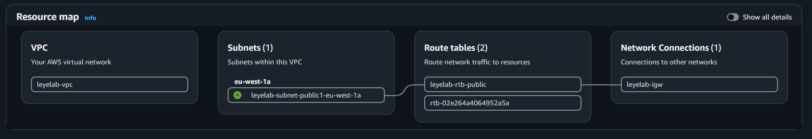

## Phase 2: Domain controller (DC01)

- Windows Server 2022 Base on t3.small (2 GiB, the minimum for the desktop version), fixed private IP `10.0.0.10`.
- Renamed to DC01, installed AD DS and created the forest `leyelab.internal` ([script](../scripts/01-promote-domain-controller.ps1)).
- Added a DNS forwarder to the AWS resolver at `10.0.0.2`, so names outside the domain resolve quickly.
- The DNS role turned out to be missing after promotion; the fix is in the [troubleshooting log](troubleshooting-log.md#3-the-domain-came-up-without-its-dns-server) and [script 02](../scripts/02-repair-dc-dns.ps1).

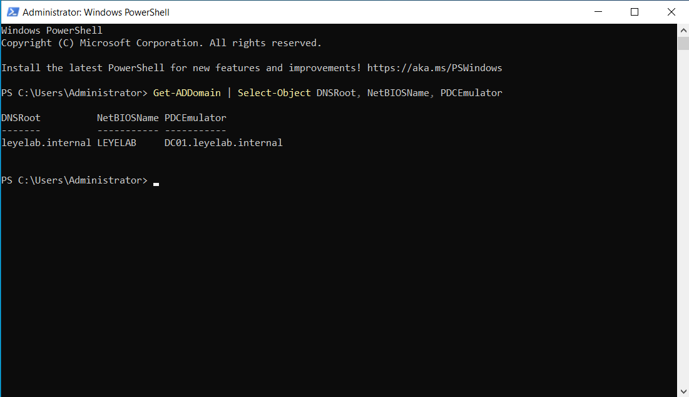

## Phase 3: OUs, users and groups

- OU structure: `LeyeLab` with `Staff`, `Groups` and `Servers` underneath. Custom OUs, because Group Policy can't be linked to the default Users and Computers containers.
- Five test users created in one PowerShell loop ([script](../scripts/03-create-ous-users-groups.ps1)).
- Security group `RDS-Users` (Global scope) with three of the five users. Remote access is granted to the group, never to individuals; the other two users are used to test refusals.

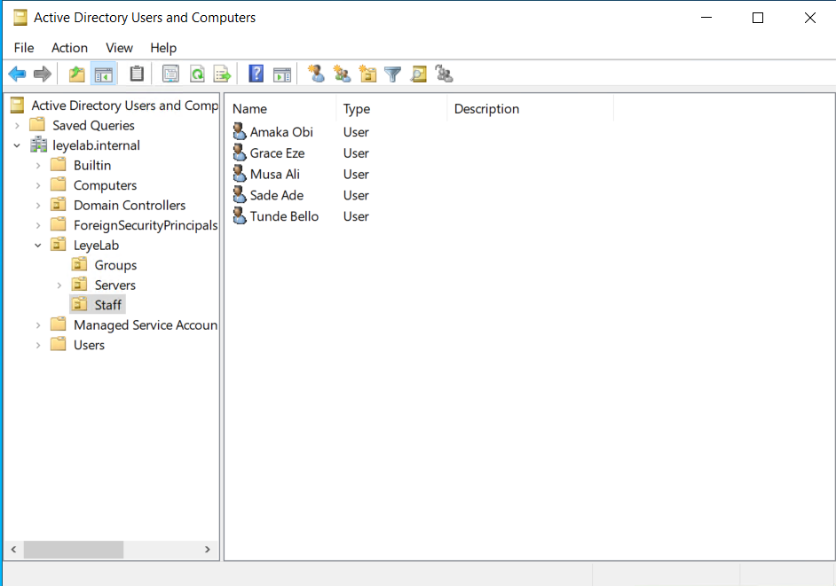

## Phase 4: Member server (RDS01)

- Windows Server 2022 on m7i-flex.large (8 GiB), fixed private IP `10.0.0.20`. I used m7i-flex.large because t3.medium isn't available on the AWS free plan, and the session host needs the memory for user sessions.
- Pointed RDS01's DNS at DC01, confirmed `leyelab.internal` resolved, then joined straight into the Servers OU ([script](../scripts/04-join-domain.ps1)).

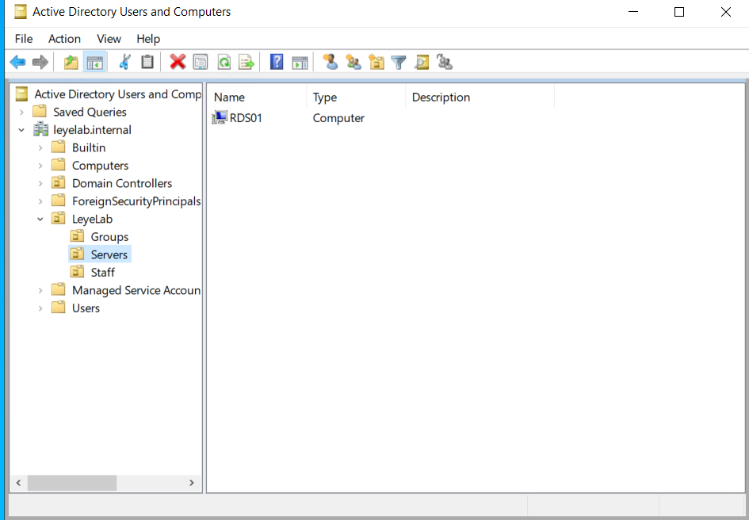

## Phase 5: Remote Desktop Services

- Standard session-based deployment through Server Manager: RD Connection Broker, RD Web Access and RD Session Host, all on RDS01.
- Collection `LabDesktops`, limited to `LEYELAB\RDS-Users`; RD Licensing in Per User mode (lab runs on the 120-day grace period); Notepad and Paint published as RemoteApps ([script](../scripts/05-rds-collection-and-remoteapps.ps1)).
- Tested as a standard user, Amaka, through RD Web Access and a full desktop session.

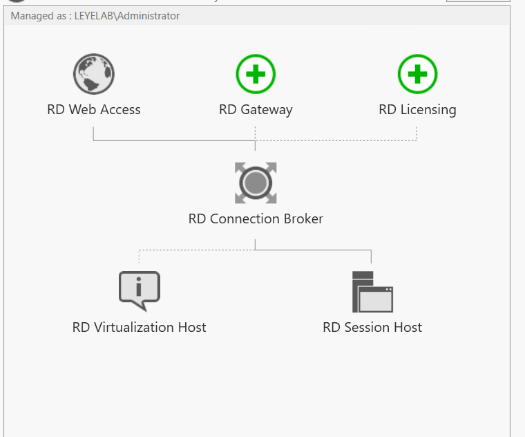
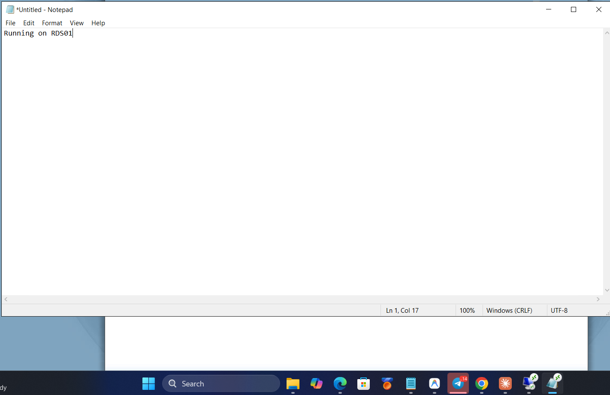

## Phase 6: Group Policy

GPO `RDP Security - Servers`, linked to the Servers OU:

| Setting | Value | Why |
| --- | --- | --- |
| Network Level Authentication | Required | Users authenticate before the server draws a login screen |
| Security layer | SSL | Session encrypted with the server's certificate |
| Encryption level | High | Strongest RDP encryption |
| Idle session limit | 30 minutes | Abandoned sessions disconnect |
| Disconnected session limit | 1 hour | Frees resources while giving users time to reconnect |
| Drive redirection | Blocked | Stops copying files between personal devices and the server |

Account lockout in the Default Domain Policy (lockout rules for domain accounts only apply at domain level): 5 attempts, 15-minute lockout, 15-minute reset. Confirmed with `gpresult /r /scope computer` on RDS01.

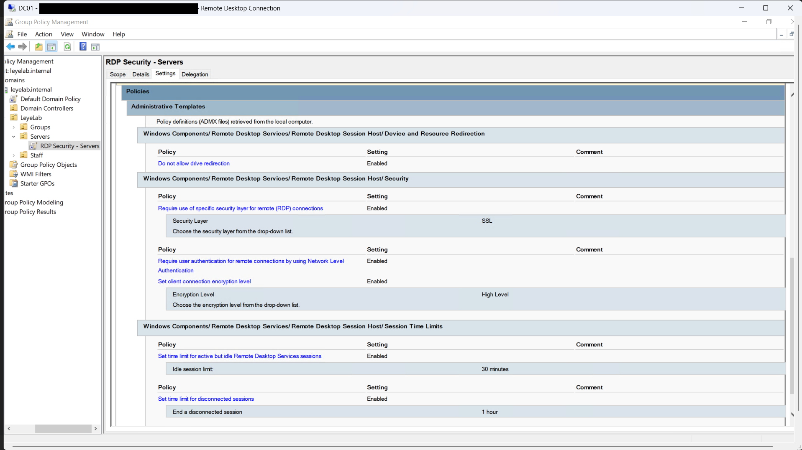

## Phase 7: RD Gateway

- Elastic IP on RDS01, so its public DNS name, and therefore the certificate name, stays fixed.
- Added the RD Gateway role, then issued one certificate with `New-SelfSignedCertificate`, valid for both the gateway's public name and `rds01.leyelab.internal`, with key usage `DigitalSignature, KeyEncipherment` ([script](../scripts/06-gateway-certificate.ps1)). Assigned it to all four RDS roles.
- Exported the public certificate and trusted it on the client laptop.
- Changed the gateway's Connection Authorization Policy from Domain Users to `LEYELAB\RDS-Users`.
- Deleted the RDP rule. The only inbound rules left are HTTPS from one IP and the internal rule.

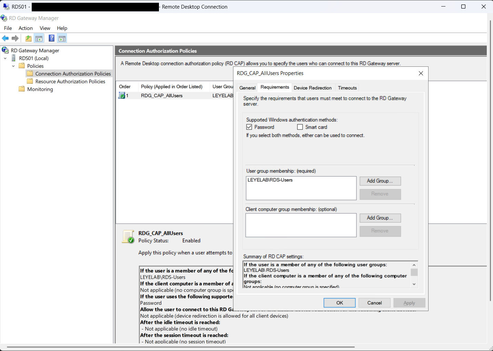
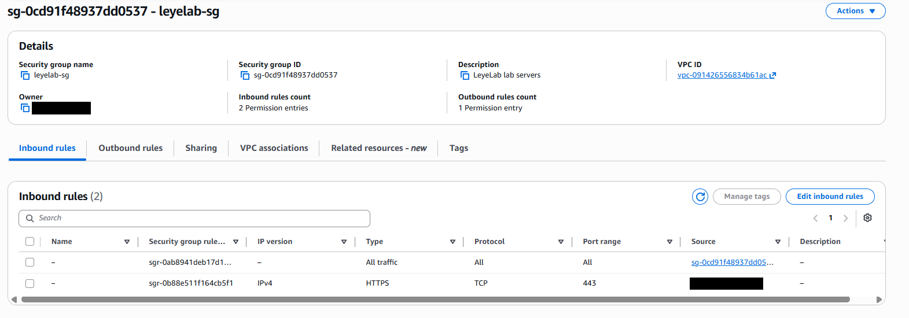
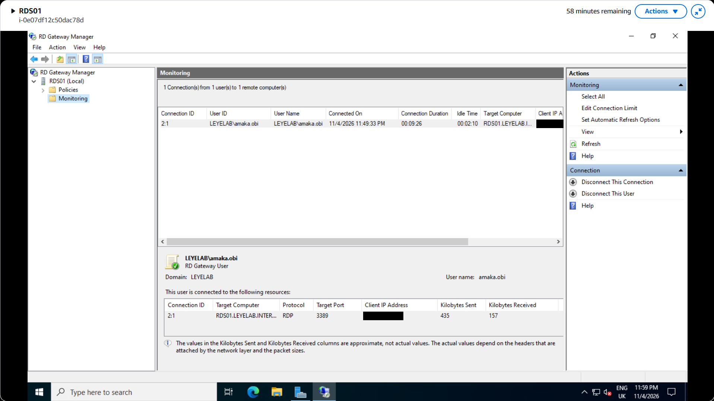

## Phase 8: Secure admin access

- Both servers appear as managed nodes in Systems Manager, because each one runs the SSM Agent and wears the IAM role from Phase 1.
- Fleet Manager gives a full remote desktop in the browser; Session Manager gives a PowerShell prompt. Neither needs an inbound port, because the agent connects outwards to AWS.

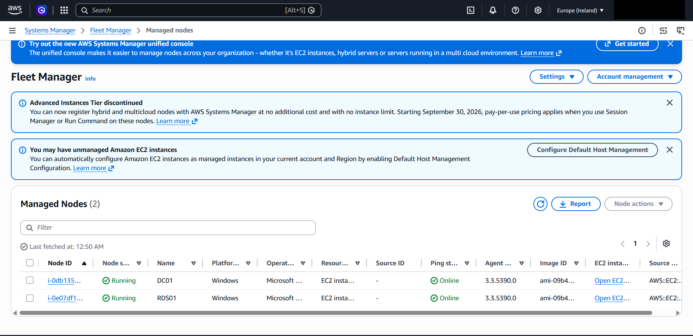
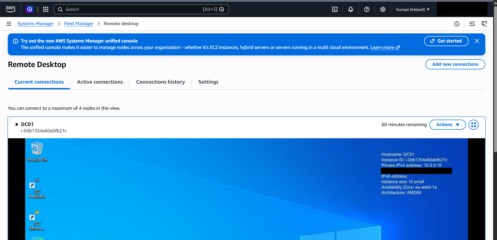
